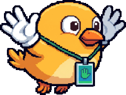
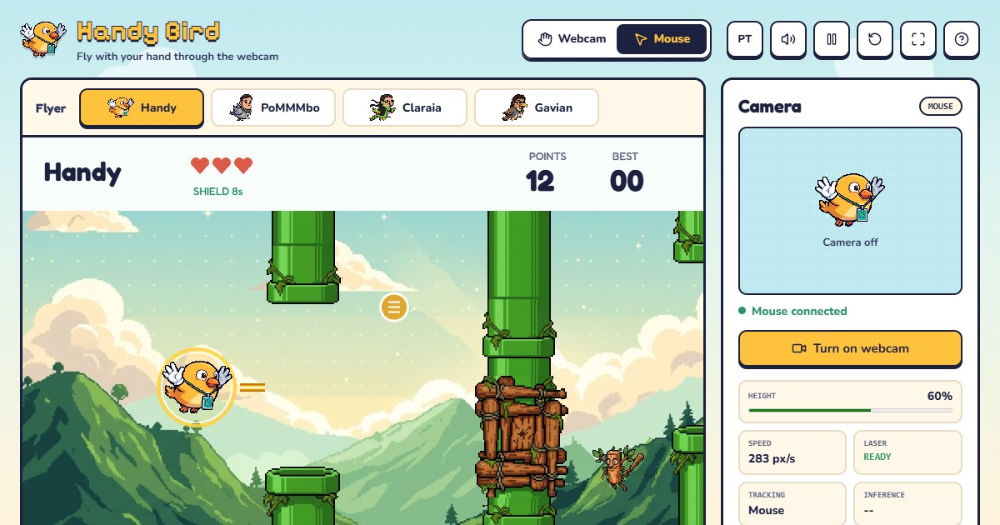
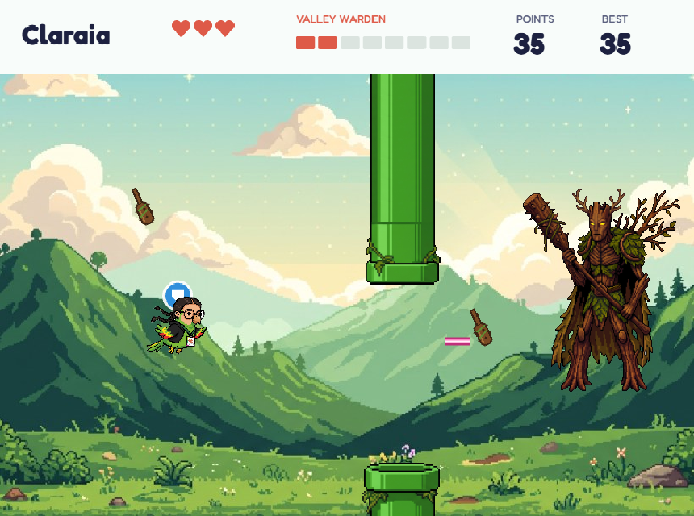

# Handy Bird

[](https://github.com/Lopespp/Handy-Bird/actions/workflows/tests.yml)
[](LICENSE)
[](https://handy-bird.netlify.app/)

**English** · [Português](README.pt-BR.md)



Handy Bird is an arcade game you play with your own hand, through the webcam. The
height of your palm becomes the height of the bird: raise your hand and it climbs,
lower it and it dives. There is no gravity and no jumping. Make a fist to fire a
laser, and hold up a peace sign (✌) to pause.

The project started as a computer vision study applied to games and grew into a
full campaign: three maps, enemies, power-ups and three bosses. Everything runs in
the browser, with no server, and the camera video never leaves your computer. The
game is available in English and Portuguese.

**[▶ Play now](https://handy-bird.netlify.app/)** ·
[How to play](#how-to-play) · [Run it locally](#run-it-locally) ·
[How it works](#how-it-works) · [Tests](#tests)



## Highlights

- **Hands-only control.** MediaPipe finds 21 hand landmarks in real time: the palm
  steers, a closed fist shoots and a peace sign pauses.
- **Four characters.** Handy, PoMMMbo, Claraia and Gavian, each with its own laser
  and shield color. You can switch in the middle of a run.
- **A campaign with an ending.** Green Valley, Tropical Beach and Final Storm, each
  with its own scenery, pipes, blockers, enemy and boss.
- **3 lives and power-ups.** Shield, slow motion and triple laser appear in random
  spots that are always reachable.
- **Difficulty that ramps up gradually.** The game speeds up as you progress and
  gives you room to breathe during boss fights.
- **No backend.** Hand tracking runs in a Web Worker, on the GPU when available.

| Area | Technology |
| --- | --- |
| Game | JavaScript (ES modules), Phaser 3 with WebGL, Web Audio |
| Computer vision | MediaPipe Tasks Vision (Hand Landmarker) in a Web Worker |
| Quality | Browser tests with Playwright, GitHub Actions on every push |
| Hosting | Netlify (static site, no build step) |

## How to play

1. Turn on the webcam and show your **open hand**, with good light in front of you.
2. The first time, the game asks for a **quick calibration** (4 s): move your hand to
   the highest and the lowest points that feel comfortable.
3. Click **Play** or simply **make a fist** to start.
4. Move your hand up and down to fly through the pipe gaps. Each pipe is one point.
5. **Make a fist** to shoot: the laser breaks the blockers that close some gaps and
   takes down the enemies crossing the screen.
6. You have **3 lives**. After each hit, the bird is invulnerable for 1.5 s.
7. Every 30 pipes, the map's boss shows up. Beat all three to finish the game.

To pause, hold a **peace sign** (index and middle fingers up, the others folded)
for a moment; make a fist to keep going. If your hand leaves the frame, the game
freezes until it comes back, with no penalty.

| Control | Action |
| --- | --- |
| Hand height | Bird height |
| Close your hand | Shoot (open and close again for the next shot) |
| Peace sign ✌ | Pause; closing your hand resumes |
| `Space` or click (Mouse mode) | Shoot |
| `P` · `R` · `M` · `F` | Pause · restart · sound · fullscreen |

Without a webcam, **Mouse mode** lets you try the game with the cursor. Since
clicking is much easier than closing your hand, this mode is 25% faster and the
laser recharges in 1 s.

<details>
<summary><strong>Detailed rules: difficulty, power-ups, enemies and bosses</strong></summary>

### Difficulty

| | Start | Per pipe | Limit |
| --- | --- | --- | --- |
| Speed | 205 px/s | +1.8 px/s | 370 px/s (at 92 pipes) |
| Distance between pipes | 380 px | −0.8 px | 300 px (at 100 pipes) |
| Gap size | 205 px | −0.4 px | 150 px (at 138 pipes) |

- Difficulty follows the total number of pipes and does not reset when the map
  changes.
- During a boss fight, pipes are 50% farther apart, gaps are 25 px larger and no
  blockers appear.
- A blocker shows up every 3 to 5 pipes: logs in the Green Valley, a net with
  sneakers on the Tropical Beach and a bomb crate in the Final Storm. One ring
  above and another below show its size.
- The fist needs to stay closed for about 80 ms, with 0.18 s between shots.

### Power-ups

In the Green Valley only the shield appears, every 10 to 14 pipes. After that, all
three types show up every 7 to 10 pipes. About a third of the time a power-up sits
inside a pipe gap; otherwise it floats between two pipes, at a random height close
to the neighboring gaps, so there is time to grab it and get back.

- **Shield:** absorbs one hit or lasts 10 s (it blinks in the last 2 s). The ring
  takes the character's color: yellow, green, pink or purple.
- **Slow motion:** pipes, boss and projectiles move at 50% for 5 s.
- **Triple laser:** three lasers per shot for 6 s.

### Enemies

Until the boss arrives, an enemy enters from the right every 3.5 to 6 s and
crosses the screen in a straight line, a little faster than the pipes. One shot
takes it down; touching it costs a life. A pipe in the way protects the enemy.

| Map | Enemy |
| --- | --- |
| 01 · Green Valley | **fadaT** |
| 02 · Tropical Beach | **Tralaleirinho** |
| 03 · Final Storm | **Bombo** |

### Bosses

| Map | Boss | Attack | Health |
| --- | --- | --- | --- |
| 01 · Green Valley | **Triple T** | Moves up and down throwing bats | 8 |
| 02 · Tropical Beach | **Tralalero Tralala** | Blows bubbles, marks your height and dashes across it | 10 |
| 03 · Final Storm | **Bombardino Crocodilo** | Drops bombs; at half health, drops two at once | 10 |

With a boss on screen, lasers go through pipes. There is no auto-fire: every shot
is a closed fist (or a click).



</details>

## Run it locally

The `web/` folder is a static site with no build step. With Python installed, run
this from the project root:

```bash
python tools/serve.py
```

and open **http://127.0.0.1:8090/** in Chrome or Edge. The page has to be served
over HTTP (opening the file directly does not work), and browsers only allow the
webcam on HTTPS or `localhost`. Phaser, fonts, icons and MediaPipe come from CDNs,
so you need an internet connection.

`tools/serve.py` works like `python -m http.server`, but it tells the browser to
always check for newer files, just like the published site. Any change shows up
on a normal reload.

## Deploy

The site is published on Netlify straight from this repository: `netlify.toml`
publishes only the `web/` folder, and `web/_headers` sets the security headers
and the cache policy. Every file is revalidated on each visit (a quick 304 when
nothing changed), so a new deploy shows up right away without version numbers in
the URLs.

## How it works

```text
Webcam → mirrored frame → MediaPipe Hand Landmarker (21 points, one hand)
       → palm center → calibrated range → One Euro Filter → bird height
       → fingers folded toward the wrist → closed fist → laser
       → index and middle extended, the rest folded → peace sign → pause
```

A few details that make a difference in how the game feels:

- **Smooth movement without lag.** The One Euro Filter (Casiez et al., 2012) removes
  jitter when the hand is still and adds almost no delay when it moves fast.
- **The right hand.** If tracking loses the hand and quickly finds another one,
  far away and of the opposite side, it is ignored for a second, so the bird
  doesn't jump around.
- **Reliable gestures.** A fist counts when at least three fingers fold toward the
  wrist, with a small margin so it doesn't flicker. The peace sign has to be held
  for 0.35 s and is never mistaken for a fist.
- **Fast in the browser.** Inference runs in a Web Worker, on the GPU when
  available, analyzing one frame at a time as soon as the camera delivers it. The
  game uses Phaser with WebGL and spends only a few milliseconds per frame.
- **Fair collisions.** The bird is a circle tested against the pipe rectangles,
  and lasers and projectiles check their whole path between frames.

Game rules live in `web/js/game.js`, separate from the camera (`camera.js`,
`tracking-worker.js`) and the drawing (`scene.js`). Interface texts in both
languages are in `web/js/i18n.js`.

## Project structure

```text
web/                    The game (static site published on Netlify)
  index.html, style.css Game page, camera panel and "How to play"
  js/                   app, game (rules), scene (Phaser), camera,
                        tracking-worker (MediaPipe), sound, i18n, tests
  assets/               Characters, bosses, enemies, scenery, pipes and icons
  _headers              Cache policy and security headers
tools/                  Local server and the scripts that generate the sprites
tests/                  Browser tests (Playwright) and site checks
docs/images/            Screenshots for this README
```

<details>
<summary><strong>How the sprites are made</strong></summary>

The sprites come from original illustrations that are not part of the repository.
With them in `art/source/`, the scripts in `tools/` remove the background, resize
to game size and line the pipes and blockers up with the collision areas:

```bash
# Characters, bosses and enemies: removes the white background and resizes
python tools/cutout.py art/source/handy.jpg web/assets/characters/handy.png --width 256
python tools/cutout.py art/source/bombardino.jpg web/assets/bosses/bombardino.png --width 250 --split-bomb web/assets/bosses/bomb.png
python tools/cutout.py fadat-crop.png web/assets/enemies/fadat.png --width 62 --fill-holes 200

# Pipes and blockers for the three maps
python tools/pipes.py art/source/canos.jpg art/source/bloqueios.jpg web/assets/stages
```

</details>

## Tests

```bash
python -m pip install -r requirements.txt
python -m playwright install chromium
python -m unittest discover -s tests -v
```

The tests need no webcam. They open the game in a headless browser, at desktop
and phone sizes, and check rules, difficulty, bosses, enemies, power-ups,
gestures, the filter, calibration, sound, drawing and both languages. On Windows,
you can use the installed Edge instead of downloading Chromium by setting
`HANDY_BIRD_BROWSER=msedge`. On GitHub, the **Tests** workflow runs everything on
every push.

## Troubleshooting

- **The camera doesn't turn on:** close Teams, Zoom or any other app using the
  camera, and check that your system allows camera access.
- **The hand isn't detected:** improve the lighting, show your whole palm and avoid
  strong light behind you.
- **The bird can't reach the top or bottom:** use **Calibrate height**.
- **The laser doesn't fire:** close your fingers with the whole hand in view, and
  open it again before the next shot.
- **The game is slow:** the camera panel should show `GPU`. If it shows `CPU`, turn
  on hardware acceleration in your browser.

## Privacy

The game doesn't record video and doesn't send camera images anywhere: the hand is
recognized on your own device. Only your high score, calibration, language and
sound preference are saved, in your browser. The MediaPipe model is downloaded
from Google's servers, which may collect metrics under the
[MediaPipe policy](https://developers.google.com/mediapipe).

## Contributing

Suggestions, issues and pull requests are welcome. Please take a look at the
[contributing guide](.github/CONTRIBUTING.md) first.

## Credits and license

Made by **Pietro Lopes** ([@Lopespp](https://github.com/Lopespp)).

The **code** is under the [MIT license](LICENSE). The **images are not covered by
it**: the sprites in `web/assets/` and the screenshots in `docs/images/` depict
real people or third-party characters and were provided for this project only. If
you want to reuse the code in another game, please use your own art. Libraries and
models follow their authors' terms.
