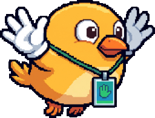
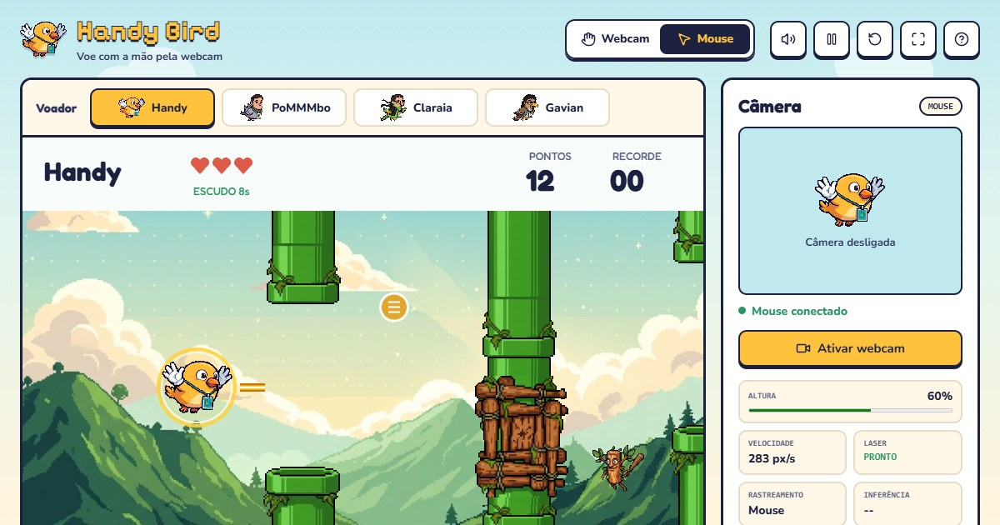
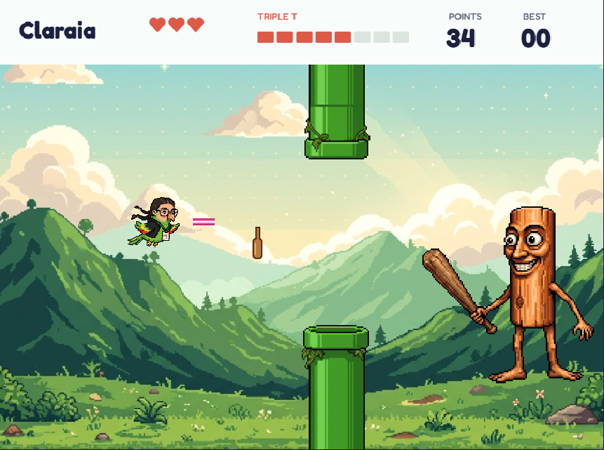

# Handy Bird

[](https://github.com/Lopespp/Handy-Bird/actions/workflows/tests.yml)
[](LICENSE)
[](https://handy-bird.netlify.app/)

[English](README.md) · **Português**



Handy Bird é um jogo arcade em que você controla o pássaro com a própria mão, pela
webcam. A altura da sua palma vira a altura do pássaro: levantou a mão, ele sobe;
abaixou, ele desce. Não tem gravidade nem pulo. Fechar o punho dispara um laser, e
o sinal de paz (✌) pausa o jogo.

O projeto começou como um estudo de visão computacional aplicada a jogos e cresceu
até virar uma campanha completa: três mapas, inimigos, power-ups e três chefes.
Tudo roda no navegador, sem servidor, e o vídeo da câmera nunca sai do seu
computador. O jogo está disponível em inglês e em português.

**[▶ Jogar agora](https://handy-bird.netlify.app/)** ·
[Como jogar](#como-jogar) · [Rodar localmente](#rodar-localmente) ·
[Como funciona](#como-funciona) · [Testes](#testes)



## Destaques

- **Controle só com a mão.** O MediaPipe encontra 21 pontos da mão em tempo real: a
  palma guia o voo, o punho fechado atira e o sinal de paz pausa.
- **Quatro personagens.** Handy, PoMMMbo, Claraia e Gavian, cada um com a cor do
  próprio laser e do próprio escudo. Dá para trocar no meio da partida.
- **Campanha com começo, meio e fim.** Vale Verde, Praia Tropical e Tempestade
  Final, cada mapa com cenário, canos, bloqueios, inimigo e chefe próprios.
- **3 vidas e power-ups.** Escudo, câmera lenta e laser triplo aparecem em lugares
  aleatórios, mas sempre alcançáveis.
- **Dificuldade que cresce aos poucos.** O jogo acelera conforme você avança e
  alivia durante as lutas contra os chefes.
- **Sem servidor.** O rastreamento da mão roda em um Web Worker, na GPU quando
  disponível.

| Área | Tecnologia |
| --- | --- |
| Jogo | JavaScript (módulos ES), Phaser 3 com WebGL, Web Audio |
| Visão computacional | MediaPipe Tasks Vision (Hand Landmarker) em um Web Worker |
| Qualidade | Testes no navegador com Playwright e GitHub Actions a cada push |
| Hospedagem | Netlify (site estático, sem etapa de build) |

## Como jogar

1. Ative a webcam e mostre a **mão aberta**, com boa luz de frente.
2. Na primeira vez, o jogo pede uma **calibração rápida** (4 s): leve a mão até o
   ponto mais alto e o mais baixo que for confortável.
3. Clique em **Jogar** ou simplesmente **feche a mão** para começar.
4. Suba e desça a mão para passar pelo vão dos canos. Cada cano vale um ponto.
5. **Feche o punho** para atirar: o laser quebra os bloqueios que fecham alguns vãos
   e derruba os inimigos que cruzam a tela.
6. Você tem **3 vidas**. Depois de cada batida, o pássaro fica invencível por 1,5 s.
7. A cada 30 canos, chega o chefe do mapa. Vença os três para terminar o jogo.

Para pausar, faça o **sinal de paz** (indicador e médio levantados, os outros dedos
dobrados) por um instante; feche a mão para continuar. Se a mão sair do quadro, o
jogo congela até ela voltar, sem perder nada.

| Controle | Ação |
| --- | --- |
| Altura da mão | Altura do pássaro |
| Fechar a mão | Atirar (abra e feche de novo para o próximo tiro) |
| Sinal de paz ✌ | Pausar; fechar a mão retoma |
| `Espaço` ou clique (modo Mouse) | Atirar |
| `P` · `R` · `M` | Pausar · novo voo · som |

Sem webcam, o **modo Mouse** permite testar o jogo com o cursor. Como clicar é bem
mais fácil do que fechar a mão, esse modo é 25% mais rápido e o laser recarrega em 1 s.

<details>
<summary><strong>Regras em detalhe: dificuldade, power-ups, inimigos e chefes</strong></summary>

### Dificuldade

| | Início | A cada cano | Limite |
| --- | --- | --- | --- |
| Velocidade | 205 px/s | +1,8 px/s | 370 px/s (aos 92 canos) |
| Distância entre canos | 380 px | −0,8 px | 300 px (aos 100 canos) |
| Abertura do vão | 205 px | −0,4 px | 150 px (aos 138 canos) |

- A dificuldade acompanha o total de canos e não volta ao início quando o mapa muda.
- Durante um chefe, os canos ficam 50% mais espaçados, os vãos ganham 25 px e não
  aparecem bloqueios.
- Um bloqueio surge a cada 3 a 5 canos: troncos no Vale Verde, rede com tênis na
  Praia Tropical e caixa com bomba na Tempestade Final. Um anel em cima e outro
  embaixo mostram o tamanho dele.
- O punho precisa ficar fechado por cerca de 80 ms, com 0,18 s entre tiros.

### Power-ups

No Vale Verde aparece só o escudo, a cada 10 a 14 canos. Depois, os três tipos
surgem a cada 7 a 10 canos. Em cerca de um terço das vezes o power-up fica no vão
de um cano; nas outras, fica entre dois canos, numa altura sorteada perto dos vãos
vizinhos, para dar tempo de buscar e voltar.

- **Escudo:** absorve uma batida ou dura 10 s (pisca nos últimos 2 s). O anel tem a
  cor do personagem: amarelo, verde, rosa ou roxo.
- **Câmera lenta:** canos, chefe e projéteis andam a 50% por 5 s.
- **Laser triplo:** três lasers por disparo durante 6 s.

### Inimigos

Até o chefe chegar, um inimigo entra pela direita a cada 3,5 a 6 s e atravessa a
tela em linha reta, um pouco mais rápido que os canos. Um tiro derruba; encostar
custa uma vida. Um cano no caminho protege o inimigo do laser.

| Mapa | Inimigo |
| --- | --- |
| 01 · Vale Verde | **fadaT** |
| 02 · Praia Tropical | **Tralaleirinho** |
| 03 · Tempestade Final | **Bombo** |

### Chefes

| Mapa | Chefe | Como ataca | Vida |
| --- | --- | --- | --- |
| 01 · Vale Verde | **Triple T** | Sobe e desce arremessando tacos | 8 |
| 02 · Praia Tropical | **Tralalero Tralala** | Solta bolhas, marca a sua altura e atravessa a tela nela | 10 |
| 03 · Tempestade Final | **Bombardino Crocodilo** | Larga bombas; com metade da vida, solta duas de uma vez | 10 |

Com um chefe na tela, os lasers atravessam os canos. Não existe tiro automático:
cada disparo é um punho fechado (ou um clique).



</details>

## Rodar localmente

A pasta `web/` é um site estático, sem etapa de build. Com Python instalado, rode
na raiz do projeto:

```bash
python tools/serve.py
```

e abra **http://127.0.0.1:8090/** no Chrome ou no Edge. A página precisa ser
servida por HTTP (abrir o arquivo direto não funciona), e o navegador só libera a
webcam em HTTPS ou em `localhost`. Phaser, fontes, ícones e o MediaPipe vêm de
CDNs, então é preciso estar conectado à internet.

O `tools/serve.py` funciona como o `python -m http.server`, mas pede ao navegador
que sempre confira se há arquivo novo, igual ao site publicado. Qualquer mudança
aparece ao recarregar a página.

## Publicação

O site é publicado no Netlify direto deste repositório: o `netlify.toml` publica só
a pasta `web/`, e o `web/_headers` define os cabeçalhos de segurança e o cache.
Todo arquivo é revalidado a cada visita (uma resposta 304 rápida quando nada
mudou), então um deploy novo aparece na hora, sem número de versão nas URLs.

## Como funciona

```text
Webcam → quadro espelhado → MediaPipe Hand Landmarker (21 pontos, uma mão)
       → centro da palma → faixa calibrada → One Euro Filter → altura do pássaro
       → dedos dobrados em relação ao pulso → punho fechado → laser
       → indicador e médio esticados, demais dobrados → sinal de paz → pausa
```

Alguns detalhes que fazem diferença na jogabilidade:

- **Movimento estável sem atraso.** O One Euro Filter (Casiez et al., 2012) filtra o
  tremor quando a mão está parada e quase não atrasa quando ela se move rápido.
- **A mão certa.** Se o rastreamento perde a mão e logo encontra outra, longe e do
  lado oposto, ela é ignorada por um segundo. Assim o pássaro não pula de lugar.
- **Gestos confiáveis.** O punho conta quando pelo menos três dedos dobram em
  direção ao pulso, com uma pequena margem para não oscilar. O sinal de paz precisa
  ser mantido por 0,35 s e nunca é confundido com o punho.
- **Rápido no navegador.** A inferência roda em um Web Worker, na GPU quando
  disponível, analisando um quadro por vez assim que a câmera o entrega. O jogo usa
  Phaser em WebGL e gasta poucos milissegundos por quadro.
- **Colisões justas.** O pássaro é um círculo testado contra os retângulos dos
  canos, e lasers e projéteis verificam todo o trajeto entre um quadro e outro.

As regras ficam em `web/js/game.js`, separadas da câmera (`camera.js`,
`tracking-worker.js`) e do desenho (`scene.js`). Os textos da interface nos dois
idiomas ficam em `web/js/i18n.js`.

## Estrutura do projeto

```text
web/                    O jogo (site estático publicado no Netlify)
  index.html, style.css Página do jogo, painel da câmera e "Como jogar"
  js/                   app, game (regras), scene (Phaser), camera,
                        tracking-worker (MediaPipe), sound, i18n, tests
  assets/               Personagens, chefes, inimigos, cenários, canos e ícones
  _headers              Política de cache e cabeçalhos de segurança
tools/                  Servidor local e os scripts que geram os sprites
tests/                  Testes no navegador (Playwright) e verificações do site
docs/images/            Capturas usadas neste README
```

<details>
<summary><strong>Como os sprites são gerados</strong></summary>

Os sprites saem de ilustrações originais, que não fazem parte do repositório. Com
elas em `art/source/`, os scripts de `tools/` recortam o fundo, reduzem para o
tamanho do jogo e alinham canos e bloqueios às áreas de colisão:

```bash
# Personagens, chefes e inimigos: remove o fundo branco e redimensiona
python tools/cutout.py art/source/handy.jpg web/assets/characters/handy.png --width 256
python tools/cutout.py art/source/bombardino.jpg web/assets/bosses/bombardino.png --width 250 --split-bomb web/assets/bosses/bomb.png
python tools/cutout.py recorte-fadat.png web/assets/enemies/fadat.png --width 62 --fill-holes 200

# Canos e bloqueios das três fases
python tools/pipes.py art/source/canos.jpg art/source/bloqueios.jpg web/assets/stages
```

</details>

## Testes

```bash
python -m pip install -r requirements.txt
python -m playwright install chromium
python -m unittest discover -s tests -v
```

Os testes não precisam de webcam. Eles abrem o jogo em um navegador headless, no
tamanho de computador e de celular, e verificam regras, dificuldade, chefes,
inimigos, power-ups, gestos, filtro, calibração, som, desenho e os dois idiomas. No
Windows, dá para usar o Edge instalado em vez de baixar o Chromium, definindo
`HANDY_BIRD_BROWSER=msedge`. No GitHub, o workflow **Tests** roda tudo a cada push.

## Problemas comuns

- **A câmera não liga:** feche Teams, Zoom ou qualquer programa que esteja usando a
  câmera e confira se o sistema permite o acesso.
- **A mão não é detectada:** melhore a iluminação, mostre a palma inteira e evite
  ficar contra a luz.
- **O pássaro não alcança o topo ou a base:** use **Calibrar altura**.
- **O laser não dispara:** feche os dedos com a mão inteira visível e abra de novo
  antes do próximo tiro.
- **Jogo lento:** o painel da câmera deve mostrar `GPU`. Se aparecer `CPU`, ative a
  aceleração de hardware do navegador.

## Privacidade

O jogo não grava vídeo e não envia imagens da câmera para lugar nenhum: a mão é
reconhecida no próprio dispositivo. Ficam salvos só o recorde, a calibração, o
idioma e a preferência de som, no seu navegador. O modelo do MediaPipe é baixado
dos servidores do Google, que podem coletar métricas conforme a
[política do MediaPipe](https://developers.google.com/mediapipe).

## Contribuindo

Sugestões, issues e pull requests são bem-vindos. Antes de começar, dê uma olhada no
[guia de contribuição](.github/CONTRIBUTING.md).

## Créditos e licença

Desenvolvido por **Pietro Lopes** ([@Lopespp](https://github.com/Lopespp)).

O **código** está sob a [licença MIT](LICENSE). As **imagens não fazem parte dessa
licença**: os sprites em `web/assets/` e as capturas em `docs/images/` retratam
pessoas reais ou personagens de terceiros e foram cedidos só para este projeto. Se
quiser reaproveitar o código em outro jogo, use imagens próprias. Bibliotecas e
modelos seguem os termos dos respectivos autores.
